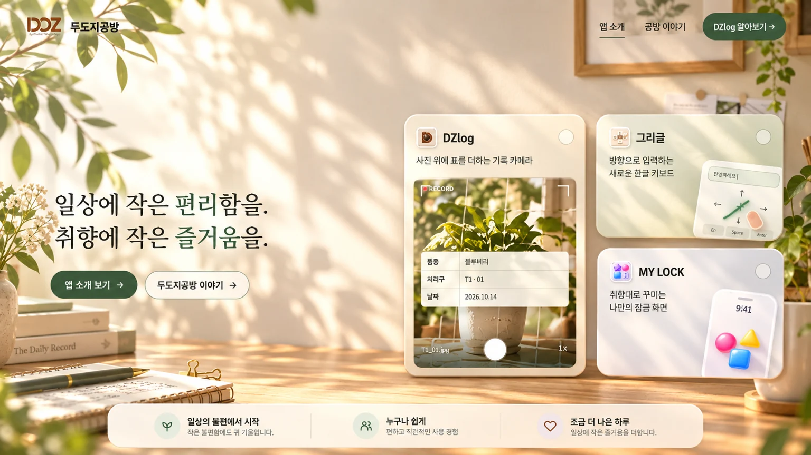
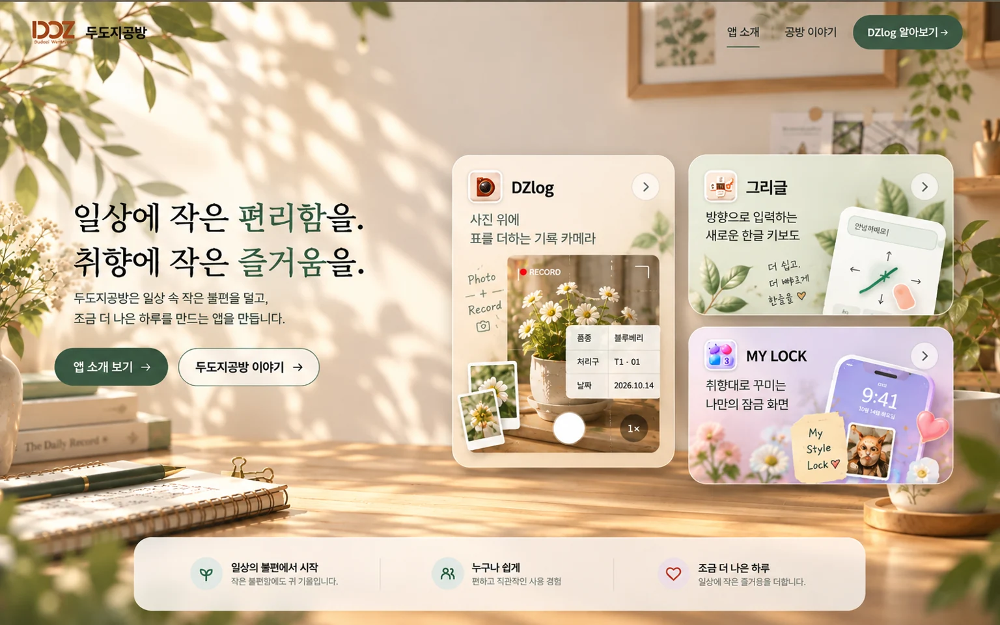

# 두도지공방 홈페이지 R5.4 카드 디자인 — 논의 인계 (2026-10-26)

> **상태: 디자인 논의 중 / 미확정 / 미구현.** 이 파일의 이미지는 *생성형 목업 참고용*이다. 그대로 완성 홈페이지에 붙여 넣지 않는다.

## 1. 확정된 운영 기준 (절대 혼동 금지)

- 운영 홈페이지: https://dudozi-workshop-site.pages.dev/
- 기준 릴리스: **R5.3**. 운영 `main` 커밋 `e3856a25a90bdbe517146fca715b392ccf34144b`.
- [릴리스 PR #5](https://github.com/Dudozi-workshop/dudozi-workshop-site/pull/5) 병합, [Cloudflare 배포 #40204867997](https://github.com/Dudozi-workshop/dudozi-workshop-site/actions/runs/40204867997) SUCCESS.
- R5.3은 햇살 드는 크림 벽/나무 책상/식물 그림자 사진을 배경 하나로 사용하고, 로고·문구·버튼·앱 카드·하단 가치 바는 별도 HTML/CSS로 렌더한다.
- 이 후속 R5.4 논의에서는 **배경과 메인 문구, 헤더, CTA, 하단 3요소 일체형 반투명 바는 기본 유지**하고 우측 앱 쇼케이스의 조형 개선에 집중한다.

## 2. 사용자 피드백 요약 (시간순)

1. **배경은 매우 만족**. 단 하단 반투명 바와 특히 우측 앱 카드들이 배경과 따로 노는 느낌.
2. 톤과 햇살/그림자로 주변 공간에 어울리게 바꾼 **2번 이미지 시안** 선호.
3. **카드가 평면적이고 단조롭다**. 각 앱의 기능과 정체성을 보여주는 입체적·서사적 구성이 필요.
4. DZlog의 가로형 실험도 있었으나 **상단 전체 폭의 DZlog 가로 카드 + 하단 2개**는 의도와 다름.
5. **정확한 배치 의도**: 오른쪽 쇼케이스 내부에서 **좌측 DZlog 1개(다소 큰 세로형), 우측 상단 그리글, 우측 하단 MY LOCK**. 우측 둘은 위아래로 반분.
6. 'DZlog 가로로 너무 길어 좀 줄여줘' — DZlog 카드 폭을 줄인 시안 생성. 사용자는 마지막 시안 뒤 'ㅇㅋㅇㅋ 다시 논의 모드'라고 함. **최종 승인이나 구현 요청이 아님**.

## 3. 참조 시안 두 장 (이 브랜치 내부 문서 자산)

### 2안 — 따뜻한 공간감과 카드 톤의 출발점

- 원본 이미지 생성 ID: `cbb32ce7-830b-4072-af04-b13c0effc072`.
- 역할: 기존 따뜻한 실내 배경/광원과 조화로운 카드 마감의 기준. 레이아웃과 타이포그래피를 1:1 완성 규격으로 확정한 것은 아님.

### 최신 — DZlog 가로 폭을 줄인 1+2 구성

- 원본 이미지 생성 ID: `d24bbad9-2f1e-43b9-b72d-8852d2b3779c`.
- 역할: 다음 채팅의 **논의 시작점**. DZlog는 왼쪽 1개, 그리글/MY LOCK은 오른쪽에서 2단. 구체적인 좌우 폭·간격·장식 밀도는 미확정.

## 4. 각 앱별 디자인 방향(제안 수준)

- **DZlog**: 실제 사진 촬영·기록·표 삽입을 알아볼 수 있도록 카메라 뷰와 표를 중심으로 구성. 사진을 담은 카드/포토 프레임의 입체감을 추가하되, 좌측 폭을 과도하게 넓히지 않기.
- **그리글**: 방향 입력·한글 키보드 사용 흐름이 드러나는 실제 기능 중심 오브젝트(키보드 패널, 입력 중인 문구)로 구성. 단순 잎·꽃 장식만으로 채우지 않기.
- **MY LOCK**: 잠금화면 꾸미기, 시계·배경·위젯·스타일을 보여주는 스마트폰 목업 중심. 입체감·겹침·작은 꾸미기 요소는 검토하되 가독성을 먼저 확보.
- **공통**: 나무 책상, 실내 햇살, 부드러운 반사·그림자, 종이/유리 질감을 일관 적용. 과도한 3D, 랜덤 스티커·장식, 과장된 아이콘/가짜 기능 UI를 경계.

## 5. 미결정 사항 — 다음 채팅에서 하나씩 논의

1. DZlog 카드의 적정 폭/높이, 3개 카드 그리드의 전체 크기와 위치(특히 1440px 기준).
2. 앱별 레이어 깊이/장식 수준과 카드 배경의 따뜻한 색상 범위.
3. DZlog 사진·표, 그리글 키보드, MY LOCK 잠금화면의 실제/승인 이미지 자산 사용 방식.
4. 필요한 경우 A/B **이미지 시안 비교 → 사용자 선택** 후 수치·CSS 반영.
5. 구현은 별도 브랜치/PR에서 진행하며 모바일 회귀·Chromium QA·비운영 프리뷰 확인 후에만 운영 반영 검토.

## 6. 금지 및 주의

- **R5.4 목업은 현재 운영 사이트에 반영되지 않았음.** 사용자 최종 시각 승인 전 `main`이나 Cloudflare 프로덕션 수정하지 말 것.
- 생성형 이미지 자체를 앱 기능/텍스트/카드가 포함된 전체 홈페이지 배경으로 사용하지 않음. 기존 HTML/CSS 인터랙션 유지.
- 기존 R5.3 배경과 슬로건 및 하단 통합 바를 임의로 전면 재설계하지 말 것.
- 장식용 메모·그림·태그는 목업의 분위기 참고이지 실제 앱 기능이나 공식 UI 문구의 근거가 아니다.

## 7. 다음 채팅 첫 문장 추천

> 두도지공방 홈페이지 R5.4 카드 디자인 논의를 이어가자. 운영 R5.3은 유지하고, GitHub `design/homepage-r54-card-study-20261026`의 두 참고 이미지 중 **최신 DZlog 폭 축소 시안**을 기준으로 하나씩 수정하자. 레이아웃은 좌측 DZlog, 우측 상단 그리글/하단 MY LOCK으로 고정한다. 우선 카드 폭·높이·간격과 세 앱별 고유한 입체 장식 요소를 비교하고, 이미지 시안을 확정한 뒤 별도 브랜치에서 구현하자. 운영 배포는 아직 금지.

---

## 8. 2026-10-30 R5.4 카드 시안 업데이트 — 사용자 선택 기록

**상태: 시안 방향 채택 / 추가 디자인 논의 중 / 코드 미구현 / R5.3 운영 유지.**

### 공통 레이아웃
- 카드 쇼케이스: 왼쪽 DZlog 1개, 오른쪽 그리글(위) + MY LOCK(아래) 2개.
- 좌/우 폭은 논의 B안 약 43:57을 잠정 기준으로 하며, 좌측 카드 상단/하단은 우측 2장 묶음의 상단/하단과 각각 일치시킨다.
- 크림 벽·책상·햇살 배경과 기존 슬로건, CTA, 하단 일체형 반투명 가치 바는 유지.
- 사진/메모/제스처/잠금화면의 입체 오브젝트는 앱별 정체성을 표현하되 과밀한 장식은 덜어낸다.
- 세 앱 모두 **공식 아이콘 원본 사용**: public/assets/app-dzlog-launcher.webp, app-grigle-launcher.webp, app-mylock-launcher.png.

### 앱별 선택안
- **DZlog: 6안 비교 중 A안 선택.** 스마트폰 제거, 큰 대표 사진에 감성형 종이 메모처럼 보이는 기록 정보; 사진 + 표 기록 + 촬영 시 자동 저장·파일명/경로 규칙에 따른 분류를 함께 표현. 콘텐츠 AI 인식으로 오해되는 폴더 분류 표현 금지. 사진과 폴더/파일 카드의 밀도 축소.
- DZlog 확정 문구: "사진과 기록을 한 번에" / "촬영과 동시에 자동 저장·분류".
- **MY LOCK: 6안 비교 중 E안 선택.** 부드러운 감성 일러스트와 스마트폰 잠금화면의 입체 레이어를 기준으로 유지. 실제 MY LOCK 자산·기능 확인이 이후 필요.
- **그리글: 기존 일반 한글 자판 키캡/새싹 아이콘 시안 폐기.** 실제 앱의 방향 제스처 기반 한국어 IME와 다른 자판을 만들지 않음. 사용자 선택: 2026-10-30 그리글 3안 비교 중 **C안**, 수정판에서 **입력 영역은 화살표(상하좌우)만 표시, ㄱ/ㄴ 글자 키캡 제거**. 입력창 + 스마트폰 속 제스처 표면 + 따뜻한 세이지/아이보리, 꽃·햇살 조합을 **이미지 감성 기준**으로 채택.
- 선택된 수정판 시안의 **상단 카메라 모양 아이콘은 생성형 임시 아이콘으로 실제 그리글 아이콘이 아님**. 다음 변형에서는 public/assets/app-grigle-launcher.webp로 반드시 대체. 스마트폰 화면 또한 실제 IME 구현을 기반으로 검수하며 정확한 스크린샷이라는 주장 금지.

### 그리글 선택 시안 원본 보관
- 2026-10-30 생성형 이미지: "따뜻한_그리글_제스처_키보드_카드.png", **1448 × 1086 PNG**, 1,614,980 bytes.
- ChatGPT Library: \`/두도지공방/R5.4-카드-시안/GRIGLE_C_arrow_only_20261030_original.png\`
- Library file ID: \`libfile_ef4d45939f788191b0f77f061f04dc50\`.
- PNG SHA-256: \`0535aca4206235a309bf4f868974f48b2eb0e9decae979ae40a94fdb8fda15cd\`.
- 이미지 생성 ID: \`0986992d-5797-493c-a643-ecf9fadf3384\` (부모: \`1de8f912-1684-458d-b3d4-2c48a7dcd711\`).
- **현재 이 이미지의 원본은 ChatGPT Library에 보관되었으며 GitHub 리포지토리에는 바이너리 이미지가 추가되지 않았다.** 원본 사용 시 Library에서 가져오거나 이 대화의 첨부 파일을 다운로드한다. 생성형 목업 자체는 실제 제품 앱 화면/아이콘을 대체할 수 없다.

### 다음 단계 (여전히 논의만 진행)
1. 그리글 C안의 시각적 깊이/꽃/제스처 궤적을 기반으로 작은 R5.4 상단 카드 비율에 맞는 가로형 구도 논의. 본 1448×1086 시안은 세로형 콘셉트 참고용이지 홈페이지 최종 크기가 아님.
2. 공식 그리글 앱 아이콘으로 교체하고, 제스처 및 하단 바의 실제 레이아웃 검수.
3. DZlog A + 그리글 C(화살표 전용) + MY LOCK E를 원래 1+2 그리드에 조합한 이미지 시안 검토.
4. **이미지 시안 최종 승인 전** HTML/CSS/JS/배포 변경 금지. R5.3 운영 유지.
